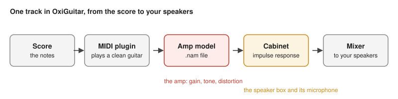
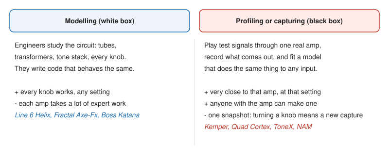
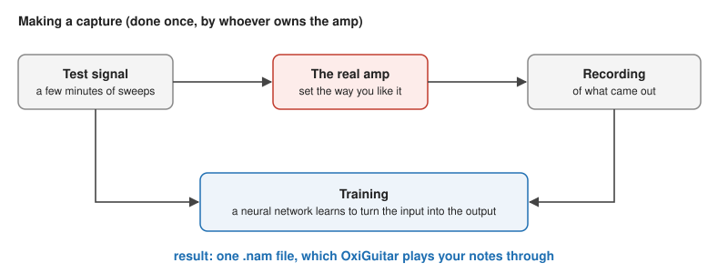

# NAM plugin

This plugin puts a real amplifier behind your guitar and bass tracks. A track plays its notes as a clean guitar, the plugin runs that sound through a capture of a real amp, then through a speaker cabinet, and what reaches your speakers sounds like a miked-up amp instead of a General MIDI guitar patch.

The captures are **NAM profiles**, made with the open-source [Neural Amp Modeler](https://www.neuralampmodeler.com/). They are the same files that a growing number of professional pedals and amp modellers load. You pick one per track in the Track tab's **Amp (NAM)** section ([How to use it](use-cases.md) shows where), and get the files yourself: thousands are free to download. The plugin downloads nothing.

This plugin needs the MIDI plugin, which makes the clean guitar sound that the amp shapes. See [its manual](https://mateusrdp.github.io/oxiguitar-midi/).

## Amp modelling and amp profiling

There are two ways to make a computer sound like a guitar amp.

**Modelling** works like an engineer would. Someone studies an amp's circuit (the tubes, the transformer, the tone stack, every knob) and writes software that behaves the same way, part by part. Done well, every knob works across its whole range, just like on the real amp. The catch is that each amp takes a lot of expert work, and how close it gets depends on how well the people writing it understood that amp. Line 6's Helix, Fractal Audio's Axe-Fx and Boss's Katana amps are modellers.

**Profiling** (also called *capturing*) treats the amp as a black box. You play a set of test signals through a real amp, set up exactly how you like it, and record what comes out. Software then works out what the amp did to the signal and builds something that does the same to anything you play into it. It needs no knowledge of the circuit, anyone who owns the amp can do it in minutes, and the result is very close to that amp *at that setting*. The catch is the other side of the same coin: a profile is a snapshot. Turn the real amp's gain knob, and you need another profile.

If you have used a **Kemper Profiler**, you know profiling: Christoph Kemper's box, first shown at NAMM in 2011, sends test tones through your amp and builds a profile from what comes back, and it made "profiling" a household word for guitarists. Neural DSP's **Quad Cortex** calls the same idea Neural Capture, and IK Multimedia's **ToneX** does it too. Many units now do both: the Quad Cortex has models and captures, and Fractal's Axe-Fx III, a modeller, now loads NAM captures as well.

## What a NAM profile is

**Neural Amp Modeler (NAM)** is profiling done with a neural network, and done in the open. Steven Atkinson, a machine-learning researcher and guitarist, started it in 2019 and published everything: the plugin, the training code and the file format, under the MIT licence.

Making a NAM profile goes like this. You play a few minutes of a standard test file through your amp (or pedal, or whole rig) and record what comes out. A neural network is then trained to turn the test file into the recording, sample by sample. When it gets that right, it has learnt how the amp responds, and it can do the same to any guitar you feed it. The trained network is saved as a `.nam` file: that file is the profile.

A profile can capture a single pedal, an amp's preamp, a whole amp, or an amp with its cabinet and microphone. In 2026 NAM got a second generation of its network, called A2, which is lighter and more accurate; older profiles are called A1 and still play.

Because the format is open, profiles are shared freely. [TONE3000](https://www.tone3000.com/) (it used to be called ToneHunt) hosts tens of thousands of them, from famous amps to boutique pedals, each with its licence.

## Same files as the pedals the pros use

NAM started as a computer plugin, but in the last couple of years hardware makers have built it into their own gear, so the same `.nam` files now run on a pedalboard:

- **Darkglass**'s Anagram, a flagship bass multi-effects unit, was the first big maker's unit to load NAM profiles.
- **Fractal Audio**'s Axe-Fx III, a fixture in professional rigs for years, loads NAM A2 profiles in a NAM Player block since its firmware 33.
- **HeadRush**'s Prime, Core and Flex Prime load them natively since a firmware update, and **Zoom**'s Neurig was built around them.
- **Dimehead**'s NAM Player is a pedal made only to play NAM profiles on stage.
- **Fender** has announced NAM support for its Tone Master Pro.
- **Valeton**, **Hotone**, **Mooer** and **NUX** pedals load them too, some after converting them with the maker's own software.

OxiGuitar uses the same technology. It loads the same `.nam` files, unchanged, and runs them with Rust libraries that are checked sample by sample against NAM's own reference code: [NeuralAmpModeler-rs](https://github.com/fabiohl/NeuralAmpModeler-rs) where it can, and [nam-rs](https://github.com/OpenSauce/nam-rs) elsewhere. Both read A1 and A2 profiles. A profile you like on your computer here is the one you would load into one of those pedals.

## What a cab IR is

A guitar amp doesn't make its sound alone. Its speakers, the wooden box they sit in, the microphone in front of them and the room around them all shape it, and most of the difference between a harsh, fizzy direct sound and a "real" recorded guitar happens there.

A **cab IR** (cabinet *impulse response*) captures that part. You play a very short click, or a sweep, through a speaker cabinet and record it with a microphone. The recording shows exactly how the cabinet, the speaker, the microphone and its position colour every frequency. Any sound can then be passed through that recording, a calculation called *convolution*, and it comes out as if it had been played through that cabinet and miked the same way. An IR is a plain `.wav` file, usually a fraction of a second long. It is the same idea as a convolution reverb, which captures a whole room.

Most NAM profiles capture the amp alone, without its cabinet, so you add a cab IR after it. That is why the plugin has two choices: the amp (a `.nam` file) and the cabinet (a `.wav` file). Four cabinets come built in, so you hear something good before you collect any of your own. A profile that already includes its cabinet needs none, and the plugin can tell.

## In short

| Term | What it is | In OxiGuitar |
| --- | --- | --- |
| Amp modelling | Software that simulates an amp's circuit | Not this plugin |
| Amp profiling, capturing | Learning one real amp's sound from test signals | What NAM does |
| NAM profile | A `.nam` file: a trained neural network that sounds like one amp, pedal or rig | The **Model** in the Amp (NAM) section |
| Cab IR | A `.wav` file: the sound of a speaker cabinet, miked | The **Cabinet** in the Amp (NAM) section |

A profile expects a clean guitar, like a real amp does. [How to use it](use-cases.md) says how to give it one.
