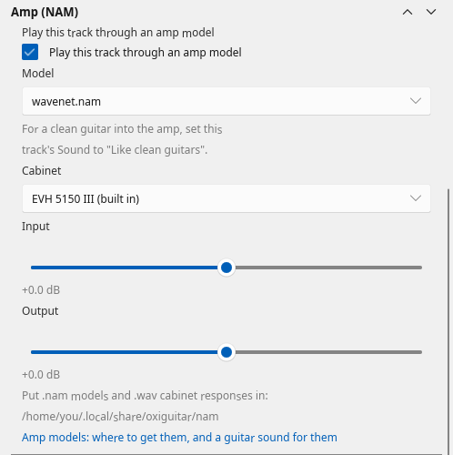
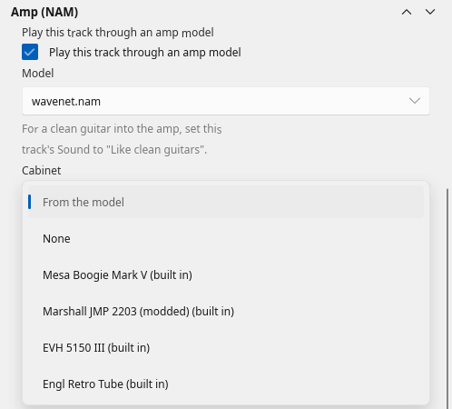
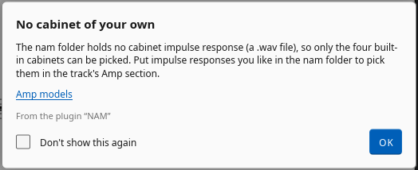
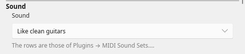
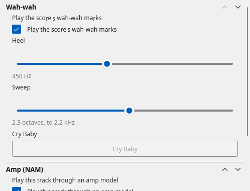
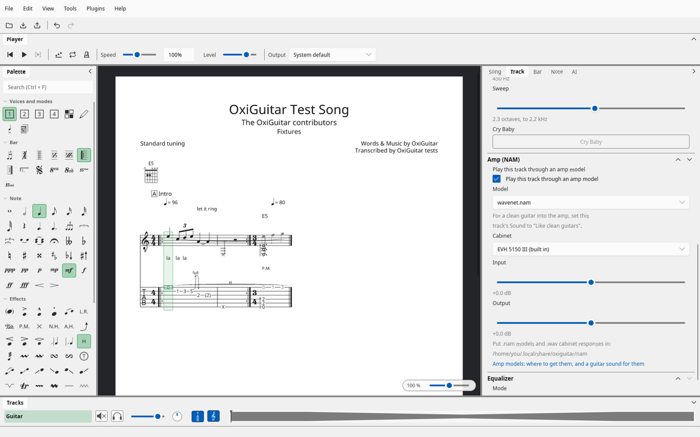

# How to use it

## 1. Get some models

The plugin plays files you bring. Before you start, put at least one amp model in the `nam` folder:

| System | The `nam` folder |
| --- | --- |
| Linux | `~/.local/share/oxiguitar/nam/` |
| macOS | `~/Library/Application Support/OxiGuitar/nam/` |
| Windows | `%APPDATA%\OxiGuitar\nam\` |
| OxiGuitar's Flatpak | `~/.var/app/io.github.mateusrdp.OxiGuitar/data/oxiguitar/nam/` |

- **Amp models** are `.nam` files. [TONE3000](https://www.tone3000.com/) has thousands for free, from famous amps to boutique pedals. Each page says what it captures and its licence. A "full rig" or "with cab" capture already includes its cabinet.
- **Cabinets** are `.wav` impulse responses. You don't need any to start: four come built in. Speaker makers and many sites offer free ones.

Subfolders are fine, up to five deep, so you can keep `Amps/`, `Pedals/` and `Cabs/` apart.

## 2. Turn the amp on for a track

1. Click a note of a guitar or bass track, and choose the **Track** tab on the right.
2. Scroll down to **Amp (NAM)** and tick **Play this track through an amp model**.
3. Pick a **Model** from your files.
4. Pick a **Cabinet**: **From the model** uses none if the model has its own and the default built-in cabinet otherwise; **None** turns it off; or pick one of the four built-in cabinets or a `.wav` of your own.

If your `nam` folder has no models, or no cabinets of your own, a dialog says so once and tells you where to put them:

## 3. Feed it a clean guitar

A real amp expects a clean guitar, and so does a profile. If the track's instrument is already a distorted guitar, the amp distorts a distorted sound and it turns to mush. Set the track's **Sound** (just above, in the same tab; it belongs to the MIDI plugin) to **Like clean guitars**:

The section reminds you of this when you pick a model.

## 4. Set the drive and the level

- **Input** drives the amp harder or softer, from −24 to +24 dB, like the volume knob on your guitar. More input means more distortion on a crunchy amp.
- **Output** sets the track's level after the amp, so a loud model doesn't drown the band.

Both work while the song plays, so set them by ear.

## Use different amps on different tracks

Each track has its own section. A rhythm guitar through one amp, a lead through another and the bass through a bass amp all play together.

## Put the equalizer before or after the amp

If you also use the equalizer or the wah-wah plugin, each effect has its own section on the Track tab, in the order they play. The small arrows at the right of a section's title move it up or down:

## Example: the whole window

